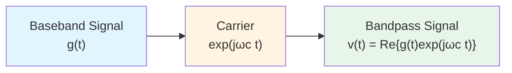
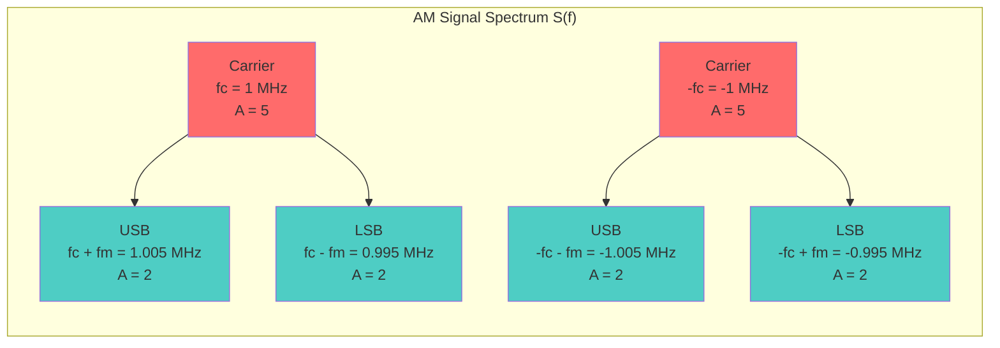
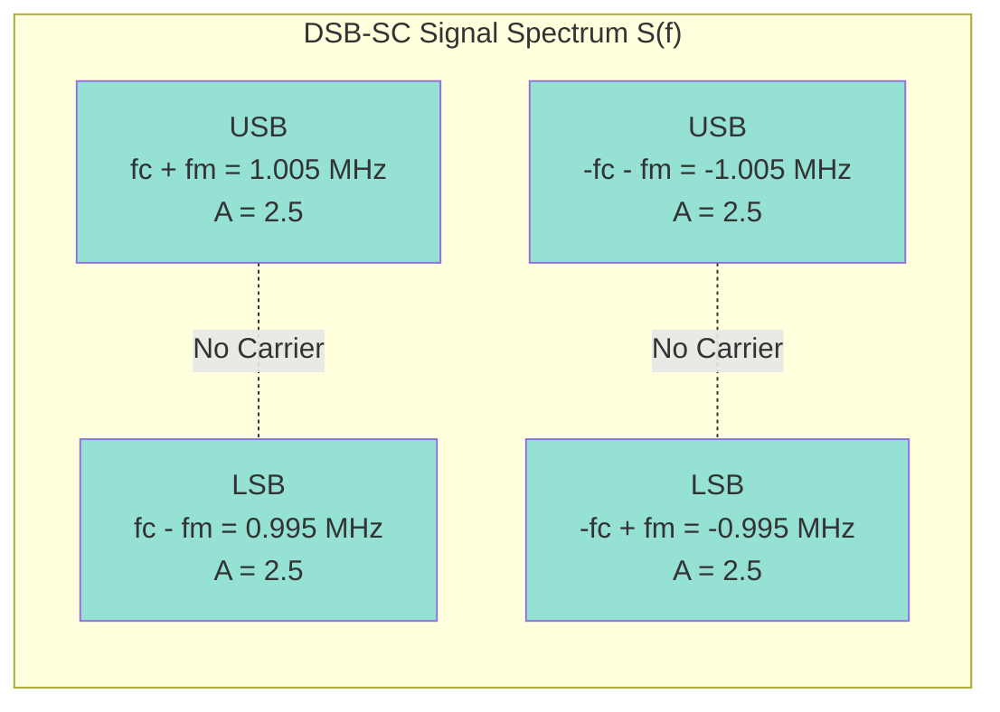
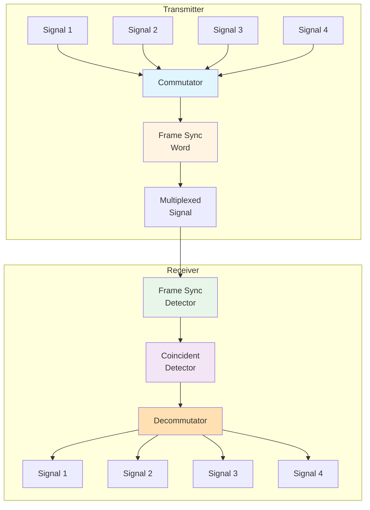
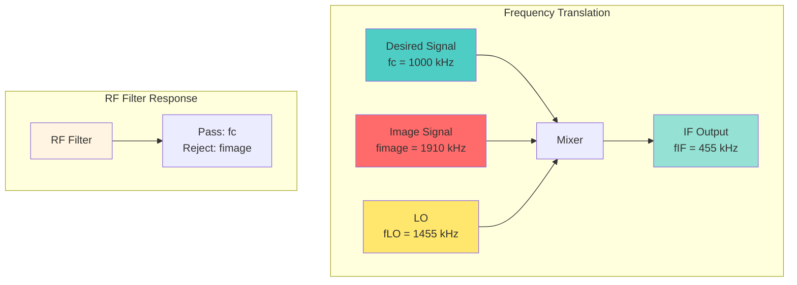

# Communication Systems - Mock Exam 1

**Time Allowed:** 2 hours  
**Total Marks:** 100 points

---

## Instructions

- Answer all questions
- Show all your work clearly
- Use appropriate formulas and justify your answers
- Calculators are permitted
- Good luck!

---

## Section A: Foundations of Modulation (Group 1) - 20 points

### Question 1 (10 points)

**a)** (5 points) A bandpass signal is given by:
$$v(t) = 5\cos(2\pi \cdot 10^6 t) + 3\sin(2\pi \cdot 10^6 t)$$

Express this signal in the form:
$$v(t) = R(t)\cos[\omega_c t + \theta(t)]$$

Find $R(t)$ and $\theta(t)$.

**b)** (5 points) For the signal in part (a), find:
- The complex envelope $g(t)$
- Express $v(t)$ in the form: $v(t) = \text{Re}\{g(t)e^{j\omega_c t}\}$

**Note:** The following diagram illustrates the complex envelope representation:



---

### Question 2 (10 points)

**a)** (4 points) Explain what is meant by the complex envelope representation of a bandpass signal. Why is this representation useful?

**b)** (3 points) A bandpass signal has complex envelope $g(t) = 2[1 + 0.5\cos(2\pi \cdot 1000 t)]$. If the carrier frequency is $f_c = 1$ MHz, find the spectrum $V(f)$ of the bandpass signal.

**c)** (3 points) For the signal in part (b), calculate the average power $P_v$ of the bandpass signal.

---

## Section B: Analog Modulation - Amplitude-based (Group 2) - 25 points

### Question 3 (12 points)

**a)** (4 points) An AM signal is given by:
$$s(t) = 10[1 + 0.8\cos(2\pi \cdot 5000 t)]\cos(2\pi \cdot 10^6 t)$$

Find:
- The modulation index $\mu$
- The carrier amplitude $A_c$
- The modulating signal $m(t)$

**b)** (4 points) For the AM signal in part (a), sketch the spectrum $S(f)$ and label all frequencies and amplitudes.

**Spectrum Diagram:**




**c)** (4 points) Calculate:
- The total average power $P_s$
- The power in the carrier
- The power in the sidebands
- The modulation efficiency $\eta$

---

### Question 4 (8 points)

**a)** (4 points) Compare Standard AM (DSB-FC), DSB-SC, and SSB-AM in terms of:
- Bandwidth
- Power efficiency
- Demodulation complexity

**b)** (4 points) A DSB-SC signal is given by:
$$s(t) = 5m(t)\cos(2\pi \cdot 10^6 t)$$

where $m(t) = 2\cos(2\pi \cdot 5000 t)$.

Find the spectrum $S(f)$ and sketch it.

**DSB-SC Spectrum Diagram:**



---

### Question 5 (5 points)

Explain how an envelope detector works. What are its advantages and limitations? When would you use a product detector instead of an envelope detector?

**Envelope Detector Block Diagram:**

```mermaid
graph LR
    A[AM Signal<br/>s(t)] --> B[Diode<br/>Rectifier]
    B --> C[RC Low-pass<br/>Filter]
    C --> D[Output<br/>m(t)]
    style A fill:#e1f5ff
    style B fill:#fff4e1
    style C fill:#e8f5e9
    style D fill:#f3e5f5
```

---

## Section C: Analog Modulation - Angle-based (Group 3) - 20 points

### Question 6 (10 points)

**a)** (3 points) A PM signal is given by:
$$s(t) = 10\cos[2\pi \cdot 10^6 t + 5\sin(2\pi \cdot 5000 t)]$$

Find:
- The phase sensitivity $D_p$
- The modulation index $\beta$
- The instantaneous frequency $f_i(t)$

**b)** (4 points) For the PM signal in part (a), if we want to convert it to an equivalent FM signal with the same modulation index, what should be the frequency sensitivity $D_f$? Assume the modulating signal is $m(t) = A_m\cos(2\pi \cdot 5000 t)$.

**c)** (3 points) Using Carson's Rule, estimate the bandwidth of the PM signal in part (a).

---

### Question 7 (10 points)

**a)** (5 points) An FM signal has:
- Carrier frequency: $f_c = 100$ MHz
- Frequency deviation: $\Delta F = 75$ kHz
- Modulating signal: $m(t) = 3\cos(2\pi \cdot 5000 t)$

Find:
- The frequency sensitivity $D_f$
- The modulation index $\beta$
- The instantaneous frequency range

**b)** (3 points) Using Bessel functions, determine how many significant sidebands are present in the FM signal spectrum.

**c)** (2 points) Calculate the total power in the FM signal.

---

## Section D: Digital & Pulse Modulation (Group 4) - 15 points

### Question 8 (8 points)

**a)** (4 points) An analog signal $w(t)$ with bandwidth $B = 4$ kHz is to be sampled.

Find:
- The minimum sampling frequency (Nyquist rate)
- If the signal is sampled at $f_s = 10$ kHz, is aliasing avoided?
- What is the maximum frequency that can be recovered without aliasing?

**Sampling Process Diagram:**

```mermaid
graph LR
    A[Analog Signal<br/>w(t), B = 4 kHz] --> B[Sampler<br/>fs = 10 kHz]
    B --> C[Sampled Signal<br/>w(nTs)]
    C --> D[Reconstruction<br/>Filter]
    D --> E[Recovered Signal<br/>w'(t)]
    style A fill:#e1f5ff
    style B fill:#fff4e1
    style C fill:#e8f5e9
    style D fill:#f3e5f5
    style E fill:#ffe0b2
```

**b)** (4 points) The sampled signal is quantized using 8 bits per sample.

Find:
- The number of quantization levels $L$
- The quantization step size $\Delta$ if the signal range is $-5$ V to $+5$ V
- The Signal-to-Quantization-Noise Ratio (SQNR) in dB

---

### Question 9 (7 points)

**a)** (3 points) Explain the difference between PAM, PWM, and PPM. What information does each modulation scheme encode?

**b)** (4 points) A delta modulator has:
- Sampling frequency: $f_s = 20$ kHz
- Step size: $\Delta = 0.1$ V
- Input signal: $w(t) = 2\sin(2\pi \cdot 2000 t)$

Determine if slope overload occurs. If yes, what should be the minimum step size to avoid it?

---

## Section E: Multiplexing (Group 5) - 10 points

### Question 10 (10 points)

**a)** (4 points) A TDM system multiplexes 4 analog signals, each with bandwidth $B = 3$ kHz.

Find:
- The minimum sampling frequency for each signal
- The total bit rate if each sample is quantized to 8 bits
- The frame rate

**b)** (3 points) Explain the role of the following components in a TDM system:
- Commutator
- Frame synchronization
- Coincident detector

**TDM System Block Diagram:**



**c)** (3 points) Compare TDM and FDM in terms of:
- Bandwidth efficiency
- Implementation complexity
- Susceptibility to interference

---

## Section F: Frequency Translation & Receiver Design (Group 6) - 10 points

### Question 11 (10 points)

**a)** (4 points) A superheterodyne AM receiver is designed to receive signals at $f_c = 1000$ kHz. The IF frequency is $f_{IF} = 455$ kHz, and high-side LO injection is used.

Find:
- The LO frequency $f_{LO}$
- The image frequency $f_{image}$
- The separation between desired and image frequencies

**Superheterodyne Receiver Block Diagram:**

```mermaid
graph LR
    A[Antenna<br/>RF Signal<br/>fc = 1000 kHz] --> B[RF<br/>Amplifier]
    B --> C[RF<br/>BPF]
    C --> D[Mixer]
    E[Local<br/>Oscillator<br/>fLO] --> D
    D --> F[IF<br/>BPF<br/>fIF = 455 kHz]
    F --> G[IF<br/>Amplifier]
    G --> H[Detector<br/>Envelope]
    H --> I[Output<br/>m(t)]
    style A fill:#e1f5ff
    style C fill:#fff4e1
    style D fill:#e8f5e9
    style E fill:#f3e5f5
    style F fill:#ffe0b2
    style H fill:#ffccbc
```

**b)** (3 points) If the RF filter provides 40 dB attenuation at the image frequency, calculate the image rejection ratio.

**c)** (3 points) Explain why the image frequency is a problem in superheterodyne receivers. How does the RF filter solve this problem?

**Image Frequency Problem Diagram:**



---

## Bonus Question (5 points)

### Question 12 (5 points)

A communication system uses both AM and FM modulation. Explain:
- Why FM generally provides better noise performance than AM
- The trade-off between bandwidth and noise performance
- When would you choose AM over FM, and vice versa?

---

**End of Exam**

*Good luck with your exam preparation!*

