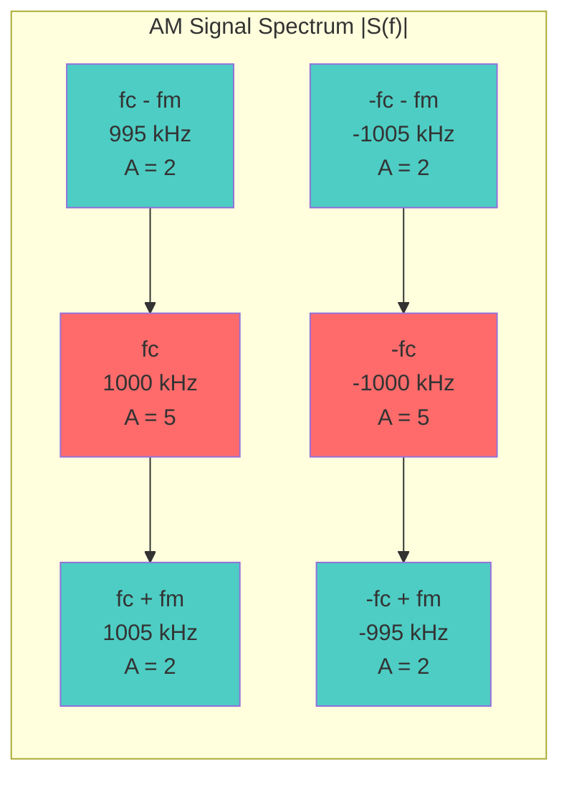
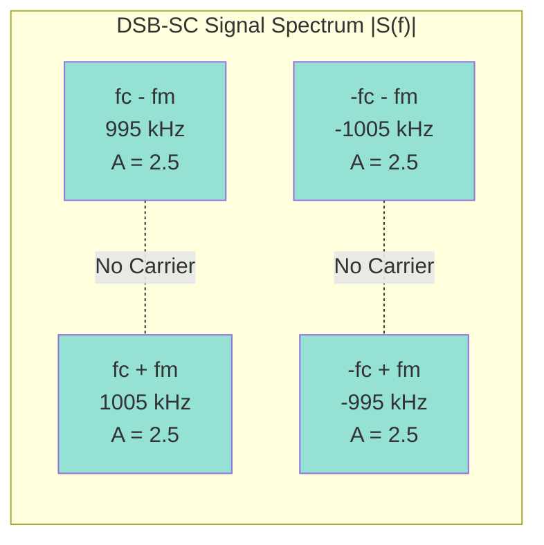
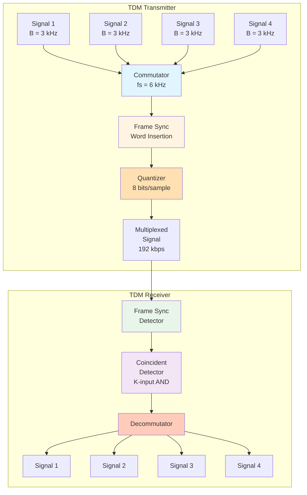
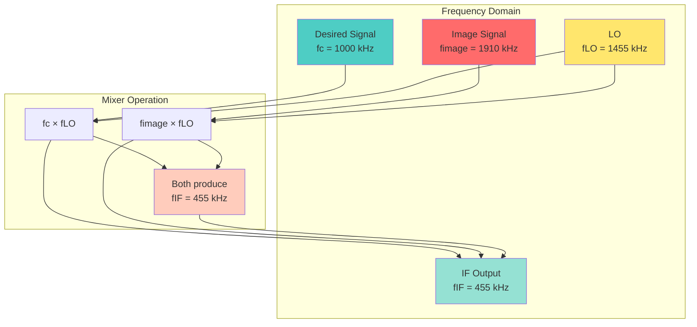

# Communication Systems - Mock Exam 1 Solutions

**Total Marks:** 100 points + 5 bonus points

---

## Section A: Foundations of Modulation (Group 1) - 20 points

### Question 1 Solution (10 points)

**a) (5 points) Express in the form $v(t) = R(t)\cos[\omega_c t + \theta(t)]$:**

**Given:**
$$v(t) = 5\cos(2\pi \cdot 10^6 t) + 3\sin(2\pi \cdot 10^6 t)$$

**From the form:** $v(t) = x(t)\cos(\omega_c t) - y(t)\sin(\omega_c t)$

We identify:
- $x(t) = 5$ (constant)
- $y(t) = -3$ (constant)
- $\omega_c = 2\pi \cdot 10^6$ rad/s, so $f_c = 10^6$ Hz = 1 MHz

**To find $R(t)$ and $\theta(t)$:**

Using the relationships:
$$R(t) = \sqrt{x^2(t) + y^2(t)} = \sqrt{5^2 + (-3)^2} = \sqrt{25 + 9} = \sqrt{34} \approx 5.83$$

$$\theta(t) = \arctan\left(\frac{y(t)}{x(t)}\right) = \arctan\left(\frac{-3}{5}\right) = \arctan(-0.6) \approx -0.540 \text{ rad} \approx -30.96°$$

**Therefore:**
$$v(t) = \sqrt{34}\cos[2\pi \cdot 10^6 t - 0.540]$$

**b) (5 points) Find complex envelope and express in complex form:**

**Complex envelope:**
$$g(t) = x(t) + jy(t) = 5 - j3$$

**Magnitude:** $|g(t)| = \sqrt{34} = R(t)$ ✓

**Phase:** $\angle g(t) = \arctan(-3/5) = \theta(t)$ ✓

**Expressing $v(t)$ in complex form:**

$$v(t) = \text{Re}\{g(t)e^{j\omega_c t}\} = \text{Re}\{(5 - j3)e^{j2\pi \cdot 10^6 t}\}$$

**Verification:**
$$\text{Re}\{(5 - j3)e^{j\omega_c t}\} = \text{Re}\{(5 - j3)(\cos(\omega_c t) + j\sin(\omega_c t))\}$$
$$= \text{Re}\{5\cos(\omega_c t) + 5j\sin(\omega_c t) - 3j\cos(\omega_c t) + 3\sin(\omega_c t)\}$$
$$= 5\cos(\omega_c t) + 3\sin(\omega_c t)$$ ✓

---

### Question 2 Solution (10 points)

**a) (4 points) Complex envelope representation:**

**Definition:**
The complex envelope representation expresses any bandpass signal as:
$$v(t) = \text{Re}\{g(t)e^{j\omega_c t}\}$$

where:
- $g(t)$ is the complex envelope (baseband, complex-valued)
- $e^{j\omega_c t}$ is the carrier (high frequency)
- $v(t)$ is the bandpass signal (real-valued)

**Why it's useful:**
1. **Simplifies analysis** - work with baseband signals instead of high-frequency signals
2. **Unified representation** - can represent any modulation type (AM, FM, PM)
3. **Easier processing** - all signal processing done at baseband
4. **Mathematical convenience** - complex algebra is simpler than trigonometric identities

**b) (3 points) Find spectrum $V(f)$:**

**Given:**
- Complex envelope: $g(t) = 2[1 + 0.5\cos(2\pi \cdot 1000 t)]$
- Carrier frequency: $f_c = 1$ MHz

**First, find $G(f)$:**

$$g(t) = 2 + \cos(2\pi \cdot 1000 t) = 2 + 0.5e^{j2\pi \cdot 1000 t} + 0.5e^{-j2\pi \cdot 1000 t}$$

$$G(f) = 2\delta(f) + 0.5\delta(f - 1000) + 0.5\delta(f + 1000)$$

**Spectrum of bandpass signal:**
$$V(f) = \frac{1}{2}[G(f - f_c) + G^*(-f - f_c)]$$

Since $g(t)$ is real, $G^*(-f) = G(f)$:

$$V(f) = \frac{1}{2}[G(f - 10^6) + G(-f - 10^6)]$$

**Substituting:**
$$V(f) = \frac{1}{2}[2\delta(f - 10^6) + 0.5\delta(f - 10^6 - 1000) + 0.5\delta(f - 10^6 + 1000)$$
$$+ 2\delta(-f - 10^6) + 0.5\delta(-f - 10^6 - 1000) + 0.5\delta(-f - 10^6 + 1000)]$$

**Simplifying:**
$$V(f) = \delta(f - 10^6) + 0.25\delta(f - 1,001,000) + 0.25\delta(f - 999,000)$$
$$+ \delta(f + 10^6) + 0.25\delta(f + 1,001,000) + 0.25\delta(f + 999,000)$$

**c) (3 points) Calculate average power:**

**Average power:**
$$P_v = \langle v^2(t) \rangle = \frac{1}{2}\langle |g(t)|^2 \rangle$$

**First, find $|g(t)|^2$:**
$$|g(t)|^2 = [2(1 + 0.5\cos(2\pi \cdot 1000 t))]^2 = 4[1 + 0.5\cos(2\pi \cdot 1000 t)]^2$$

$$= 4[1 + \cos(2\pi \cdot 1000 t) + 0.25\cos^2(2\pi \cdot 1000 t)]$$

$$= 4[1 + \cos(2\pi \cdot 1000 t) + 0.25 \cdot \frac{1 + \cos(4\pi \cdot 1000 t)}{2}]$$

$$= 4[1 + \cos(2\pi \cdot 1000 t) + 0.125 + 0.125\cos(4\pi \cdot 1000 t)]$$

$$= 4.5 + 4\cos(2\pi \cdot 1000 t) + 0.5\cos(4\pi \cdot 1000 t)$$

**Average:**
$$\langle |g(t)|^2 \rangle = 4.5$$ (DC term only, cosine terms average to zero)

**Therefore:**
$$P_v = \frac{1}{2} \times 4.5 = 2.25 \text{ W}$$

---

## Section B: Analog Modulation - Amplitude-based (Group 2) - 25 points

### Question 3 Solution (12 points)

**a) (4 points) Find modulation parameters:**

**Given:**
$$s(t) = 10[1 + 0.8\cos(2\pi \cdot 5000 t)]\cos(2\pi \cdot 10^6 t)$$

**Standard AM form:** $s(t) = A_c[1 + m(t)]\cos(\omega_c t)$

**Comparing:**
- Carrier amplitude: $A_c = 10$ V
- Modulating signal: $m(t) = 0.8\cos(2\pi \cdot 5000 t)$
- Modulation index: $\mu = \max|m(t)| = 0.8$ (or 80%)

**b) (4 points) Sketch spectrum:**

**Spectrum formula:**
$$S(f) = \frac{A_c}{2}[\delta(f - f_c) + M(f - f_c) + \delta(f + f_c) + M(f + f_c)]$$

**For $m(t) = 0.8\cos(2\pi \cdot 5000 t)$:**
$$M(f) = 0.4[\delta(f - 5000) + \delta(f + 5000)]$$

**Therefore:**
$$S(f) = 5[\delta(f - 10^6) + 0.4\delta(f - 10^6 - 5000) + 0.4\delta(f - 10^6 + 5000)$$
$$+ \delta(f + 10^6) + 0.4\delta(f + 10^6 - 5000) + 0.4\delta(f + 10^6 + 5000)]$$

**Spectrum components:**
- Carrier at $f_c = 1$ MHz: amplitude = 5
- Upper sideband at $f_c + f_m = 1,005,000$ Hz: amplitude = 2
- Lower sideband at $f_c - f_m = 995,000$ Hz: amplitude = 2
- Negative frequencies: same pattern

**Spectrum Diagram:**



**c) (4 points) Calculate powers:**

**Total average power:**
$$P_s = \frac{1}{2}A_c^2[1 + P_m]$$

**Power of modulating signal:**
$$P_m = \langle m^2(t) \rangle = \langle [0.8\cos(2\pi \cdot 5000 t)]^2 \rangle = 0.64 \times \frac{1}{2} = 0.32$$

**Therefore:**
$$P_s = \frac{1}{2} \times 10^2 \times [1 + 0.32] = 50 \times 1.32 = 66 \text{ W}$$

**Carrier power:**
$$P_c = \frac{1}{2}A_c^2 = \frac{1}{2} \times 100 = 50 \text{ W}$$

**Sideband power:**
$$P_{SB} = P_s - P_c = 66 - 50 = 16 \text{ W}$$

**Modulation efficiency:**
$$\eta = \frac{P_{SB}}{P_s} = \frac{16}{66} = 0.2424 = 24.24\%$$

---

### Question 4 Solution (8 points)

**a) (4 points) Comparison:**

| Feature | Standard AM (DSB-FC) | DSB-SC | SSB-AM |
|---------|---------------------|--------|--------|
| **Bandwidth** | $2B$ | $2B$ | $B$ |
| **Power Efficiency** | Low (~33% max) | Medium (100% of sideband power) | High (100% of sideband power) |
| **Demodulation** | Simple (envelope detector) | Requires coherent detection | Requires coherent detection |
| **Carrier** | Present | Suppressed | Suppressed |
| **Complexity** | Simplest | Moderate | Most complex (needs Hilbert transform) |

**b) (4 points) DSB-SC spectrum:**

**Given:**
$$s(t) = 5m(t)\cos(2\pi \cdot 10^6 t)$$
$$m(t) = 2\cos(2\pi \cdot 5000 t)$$

**Spectrum of $m(t)$:**
$$M(f) = \delta(f - 5000) + \delta(f + 5000)$$

**DSB-SC spectrum:**
$$S(f) = \frac{1}{2}[M(f - f_c) + M(f + f_c)]$$

$$S(f) = \frac{5}{2}[\delta(f - 10^6 - 5000) + \delta(f - 10^6 + 5000)$$
$$+ \delta(f + 10^6 - 5000) + \delta(f + 10^6 + 5000)]$$

**Amplitude at each sideband:** $2.5$

**Spectrum:**
- Upper sideband at $1,005,000$ Hz: amplitude = 2.5
- Lower sideband at $995,000$ Hz: amplitude = 2.5
- No carrier component!

**DSB-SC Spectrum Diagram:**



---

### Question 5 Solution (5 points)

**Envelope Detector:**

**How it works:**
1. **Input:** AM signal $s(t) = A_c[1 + m(t)]\cos(\omega_c t)$
2. **Rectification:** Diode rectifies the signal (removes negative half)
3. **Low-pass filtering:** RC circuit smooths the rectified signal
4. **Output:** Proportional to envelope $R(t) = A_c[1 + m(t)]$

**Envelope Detector Block Diagram:**

```mermaid
graph LR
    A[AM Signal<br/>s(t)] --> B[Diode<br/>Rectifier]
    B --> C[RC Low-pass<br/>Filter<br/>1/2πRC << B]
    C --> D[Output<br/>K·R(t) = K·Ac[1+m(t)]]
    style A fill:#e1f5ff
    style B fill:#fff4e1
    style C fill:#e8f5e9
    style D fill:#f3e5f5
```

**Mathematical operation:**
$$v_{out}(t) = K R(t) = K A_c[1 + m(t)]$$

**Advantages:**
- Simple circuit (diode + RC)
- No local oscillator needed
- Inexpensive
- Good for standard AM

**Limitations:**
- Nonlinear operation
- Cannot demodulate DSB-SC or SSB
- Sensitive to amplitude variations
- Requires $|m(t)| < 1$

**When to use Product Detector:**

**Use product detector when:**
- Demodulating DSB-SC or SSB signals
- Need linear demodulation
- Better noise performance required
- Coherent detection available (synchronized LO)

**Product detector:**
$$v_{out}(t) = \frac{1}{2}A_0 R(t)\cos[\theta(t) - \theta_0]$$

For AM with $\theta_0 = 0$:
$$v_{out}(t) = \frac{1}{2}A_0 A_c[1 + m(t)]$$

---

## Section C: Analog Modulation - Angle-based (Group 3) - 20 points

### Question 6 Solution (10 points)

**a) (3 points) Find PM parameters:**

**Given:**
$$s(t) = 10\cos[2\pi \cdot 10^6 t + 5\sin(2\pi \cdot 5000 t)]$$

**Standard PM form:** $s(t) = A_c\cos[\omega_c t + D_p m_p(t)]$

**Comparing:**
- Carrier amplitude: $A_c = 10$ V
- Phase deviation: $D_p m_p(t) = 5\sin(2\pi \cdot 5000 t)$
- Modulating signal: $m_p(t) = \sin(2\pi \cdot 5000 t)$
- Phase sensitivity: $D_p = 5$ rad/V
- Modulation index: $\beta = D_p \max|m_p(t)| = 5 \times 1 = 5$

**Instantaneous frequency:**
$$f_i(t) = f_c + \frac{1}{2\pi}\frac{d\theta(t)}{dt}$$

$$\frac{d\theta(t)}{dt} = \frac{d}{dt}[5\sin(2\pi \cdot 5000 t)] = 5 \times 2\pi \cdot 5000 \cos(2\pi \cdot 5000 t)$$

$$f_i(t) = 10^6 + \frac{1}{2\pi} \times 5 \times 2\pi \cdot 5000 \cos(2\pi \cdot 5000 t)$$

$$f_i(t) = 10^6 + 25,000\cos(2\pi \cdot 5000 t) \text{ Hz}$$

**Frequency range:** $10^6 \pm 25,000$ Hz = 975 kHz to 1025 kHz

**b) (4 points) Convert to equivalent FM:**

**For PM:** $\theta(t) = D_p m_p(t) = 5\sin(2\pi \cdot 5000 t)$

**For equivalent FM:** We need $\frac{d\theta(t)}{dt} = D_f m_f(t)$

**Given:** $m_f(t) = A_m\cos(2\pi \cdot 5000 t)$

**For PM:**
$$\frac{d\theta(t)}{dt} = 5 \times 2\pi \cdot 5000 \cos(2\pi \cdot 5000 t) = 50,000\pi \cos(2\pi \cdot 5000 t)$$

**For FM:**
$$\frac{d\theta(t)}{dt} = D_f A_m\cos(2\pi \cdot 5000 t)$$

**Equating:**
$$D_f A_m = 50,000\pi$$

**If $A_m = 1$ V:**
$$D_f = 50,000\pi \text{ rad/s per volt} = 157,080 \text{ rad/s per volt}$$

**Modulation index:**
$$\beta_f = \frac{D_f A_m}{2\pi f_m} = \frac{50,000\pi}{2\pi \cdot 5000} = \frac{50,000}{10,000} = 5$$ ✓

**c) (3 points) Carson's Rule bandwidth:**

**Carson's Rule:**
$$B_T \approx 2(\Delta F + B)$$

**For PM:**
- Frequency deviation: $\Delta F = \frac{1}{2\pi} \max\left|\frac{d\theta(t)}{dt}\right| = \frac{50,000\pi}{2\pi} = 25,000$ Hz
- Modulating signal bandwidth: $B = f_m = 5000$ Hz

**Therefore:**
$$B_T \approx 2(25,000 + 5000) = 2 \times 30,000 = 60,000 \text{ Hz} = 60 \text{ kHz}$$

---

### Question 7 Solution (10 points)

**a) (5 points) Find FM parameters:**

**Given:**
- Carrier: $f_c = 100$ MHz
- Frequency deviation: $\Delta F = 75$ kHz
- Modulating signal: $m(t) = 3\cos(2\pi \cdot 5000 t)$

**Frequency sensitivity:**
For FM: $\Delta F = \frac{1}{2\pi}D_f \max|m(t)|$

$$\Delta F = \frac{1}{2\pi}D_f \times 3 = 75,000$$

$$D_f = \frac{75,000 \times 2\pi}{3} = 50,000\pi \text{ rad/s per volt} = 157,080 \text{ rad/s per volt}$$

**Modulation index:**
$$\beta = \frac{\Delta F}{f_m} = \frac{75,000}{5,000} = 15$$

**Instantaneous frequency:**
$$f_i(t) = f_c + \frac{1}{2\pi}D_f m(t) = 100 \times 10^6 + \frac{1}{2\pi} \times 50,000\pi \times 3\cos(2\pi \cdot 5000 t)$$

$$f_i(t) = 100 \times 10^6 + 75,000\cos(2\pi \cdot 5000 t) \text{ Hz}$$

**Frequency range:**
- Minimum: $100,000,000 - 75,000 = 99,925,000$ Hz = 99.925 MHz
- Maximum: $100,000,000 + 75,000 = 100,075,000$ Hz = 100.075 MHz

**b) (3 points) Significant sidebands:**

**Using Bessel functions with $\beta = 15$:**

**Rule of thumb:** Number of significant sidebands $\approx \beta + 1 = 15 + 1 = 16$

**More precisely:** We need $J_n(\beta)$ for $n$ such that $|J_n(\beta)|$ is significant.

For $\beta = 15$:
- Significant sidebands extend to approximately $n = \beta + 1 = 16$
- Total significant components: $2n + 1 = 2(16) + 1 = 33$ components
- Sidebands at: $f_c \pm nf_m$ for $n = 1, 2, \ldots, 16$

**c) (2 points) Total power:**

**For angle-modulated signals, power is constant:**
$$P_s = \frac{1}{2}A_c^2 = \frac{1}{2} \times 10^2 = 50 \text{ W}$$

**Note:** Power is independent of modulation index!

---

## Section D: Digital & Pulse Modulation (Group 4) - 15 points

### Question 8 Solution (8 points)

**a) (4 points) Sampling parameters:**

**Given:**
- Signal bandwidth: $B = 4$ kHz

**Nyquist rate:**
$$f_{Nyquist} = 2B = 2 \times 4000 = 8,000 \text{ Hz} = 8 \text{ kHz}$$

**Sampling at $f_s = 10$ kHz:**
Since $f_s = 10$ kHz > $f_{Nyquist} = 8$ kHz, **aliasing is avoided** ✓

**Maximum recoverable frequency:**
$$f_{max} = \frac{f_s}{2} = \frac{10,000}{2} = 5,000 \text{ Hz} = 5 \text{ kHz}$$

**b) (4 points) Quantization:**

**Number of levels:**
$$L = 2^8 = 256 \text{ levels}$$

**Quantization step size:**
$$\Delta = \frac{V_{max} - V_{min}}{L} = \frac{5 - (-5)}{256} = \frac{10}{256} = 0.0390625 \text{ V} \approx 39.06 \text{ mV}$$

**SQNR:**
For uniform quantization:
$$\text{SQNR} = 6.02n + 1.76 \text{ dB}$$

where $n = 8$ bits:
$$\text{SQNR} = 6.02 \times 8 + 1.76 = 48.16 + 1.76 = 49.92 \text{ dB}$$

**Alternatively:**
$$\text{SQNR} = 10\log_{10}\left(\frac{12 \times \text{Signal Power}}{\Delta^2}\right)$$

---

### Question 9 Solution (7 points)

**a) (3 points) PAM, PWM, PPM comparison:**

**PAM (Pulse Amplitude Modulation):**
- **Encodes:** Amplitude of the analog signal
- **Pulse parameter:** Amplitude varies with signal
- **Information:** Signal amplitude at sampling instant

**PWM (Pulse Width Modulation):**
- **Encodes:** Width/duration of pulses
- **Pulse parameter:** Pulse width varies with signal
- **Information:** Signal amplitude determines pulse duration

**PPM (Pulse Position Modulation):**
- **Encodes:** Position/timing of narrow pulses
- **Pulse parameter:** Pulse position varies with signal
- **Information:** Signal amplitude determines pulse position relative to clock

**b) (4 points) Delta modulation slope overload:**

**Given:**
- Sampling frequency: $f_s = 20$ kHz
- Step size: $\Delta = 0.1$ V
- Input: $w(t) = 2\sin(2\pi \cdot 2000 t)$

**Maximum slope of input:**
$$\left|\frac{dw(t)}{dt}\right|_{max} = |2 \times 2\pi \cdot 2000 \cos(2\pi \cdot 2000 t)|_{max} = 4\pi \cdot 2000 = 25,133 \text{ V/s}$$

**Maximum slope that can be tracked:**
$$\left(\frac{dw}{dt}\right)_{max,DM} = \frac{\Delta}{T_s} = \Delta \times f_s = 0.1 \times 20,000 = 2,000 \text{ V/s}$$

**Comparison:**
$$25,133 > 2,000$$

**Slope overload occurs!** ✓

**Minimum step size to avoid slope overload:**
$$\Delta_{min} = \frac{\left|\frac{dw}{dt}\right|_{max}}{f_s} = \frac{25,133}{20,000} = 1.257 \text{ V}$$

**Therefore:** $\Delta \geq 1.257$ V to avoid slope overload

---

## Section E: Multiplexing (Group 5) - 10 points

### Question 10 Solution (10 points)

**a) (4 points) TDM system parameters:**

**Given:**
- Number of signals: $N = 4$
- Bandwidth per signal: $B = 3$ kHz
- Quantization: 8 bits per sample

**Minimum sampling frequency per signal:**
$$f_{s,min} = 2B = 2 \times 3000 = 6,000 \text{ Hz} = 6 \text{ kHz}$$

**Total bit rate:**
For each signal:
- Sampling rate: $f_s = 6$ kHz (minimum)
- Bits per sample: $n = 8$
- Bit rate per signal: $R_1 = f_s \times n = 6000 \times 8 = 48,000$ bps

**Total bit rate:**
$$R_{total} = N \times R_1 = 4 \times 48,000 = 192,000 \text{ bps} = 192 \text{ kbps}$$

**Frame rate:**
Frame rate = Sampling rate = $6,000$ frames/second

**TDM System Architecture Diagram:**



**b) (3 points) TDM components:**

**Commutator:**
- **Function:** Sequentially samples each input signal
- **Operation:** Rotates through all channels at sampling rate
- **Output:** Time-interleaved samples from all channels

**Frame synchronization:**
- **Function:** Identifies frame boundaries
- **Method:** Uses unique sync word/pattern
- **Purpose:** Ensures receiver knows which sample belongs to which channel
- **Critical:** Without sync, receiver cannot demultiplex correctly

**Coincident detector:**
- **Function:** Detects frame synchronization pattern
- **Operation:** Compares received pattern with expected sync word
- **Output:** Frame sync signal when pattern matches
- **Implementation:** K-input AND gate (all bits must match)

**c) (3 points) TDM vs FDM:**

| Feature | TDM | FDM |
|---------|-----|-----|
| **Bandwidth Efficiency** | High (all channels share full bandwidth) | Lower (each channel needs separate frequency band) |
| **Implementation Complexity** | Moderate (needs synchronization) | Simpler (just frequency division) |
| **Susceptibility to Interference** | Less (time-based separation) | More (frequency-based, crosstalk possible) |
| **Synchronization** | Required (critical) | Not required |
| **Flexibility** | Easy to add/remove channels | Harder (need frequency planning) |

---

## Section F: Frequency Translation & Receiver Design (Group 6) - 10 points

### Question 11 Solution (10 points)

**a) (4 points) Receiver parameters:**

**Given:**
- Desired signal: $f_c = 1000$ kHz
- IF frequency: $f_{IF} = 455$ kHz
- High-side LO injection

**LO frequency:**
$$f_{LO} = f_c + f_{IF} = 1000 + 455 = 1455 \text{ kHz}$$

**Image frequency:**
$$f_{image} = f_c + 2f_{IF} = 1000 + 2(455) = 1910 \text{ kHz}$$

**Separation:**
$$\Delta f = f_{image} - f_c = 1910 - 1000 = 910 \text{ kHz}$$

**b) (3 points) Image rejection ratio:**

**40 dB attenuation means:**
$$\text{Power ratio} = 10^{-40/10} = 10^{-4} = 0.0001$$

**Image rejection ratio:**
$$\text{Rejection Ratio} = \frac{1}{0.0001} = 10,000 = 40 \text{ dB}$$

**Image signal is 10,000× weaker than desired signal** (after RF filtering).

**c) (3 points) Image frequency problem:**

**The Problem:**
1. **Both desired and image produce IF:**
   - Desired at $f_c$: $f_{LO} - f_c = f_{IF}$ ✓
   - Image at $f_{image}$: $f_{image} - f_{LO} = f_{IF}$ ✓

2. **Cannot separate at IF:**
   - Both signals appear at same IF frequency
   - Interference occurs
   - Desired signal corrupted

3. **Why it happens:**
   - Mixer always produces sum and difference frequencies
   - Image frequency is exactly $2f_{IF}$ away from desired
   - Both produce same difference frequency

**Image Frequency Problem Visualization:**



**Solution - RF Filter:**
1. **RF filter before mixer:**
   - Passes desired signal at $f_c$ (low loss)
   - Rejects image at $f_{image}$ (high attenuation, 40-60 dB)

2. **Why it works:**
   - Image removed before mixing
   - Only desired signal reaches mixer
   - No interference at IF

3. **Requirements:**
   - Good selectivity (sharp filter)
   - High rejection at image frequency
   - Low loss at desired frequency

---

## Bonus Question Solution (5 points)

### Question 12 Solution (5 points)

**FM vs AM noise performance:**

**Why FM has better noise performance:**

1. **Constant amplitude:**
   - FM: Amplitude constant, only phase/frequency varies
   - AM: Amplitude varies with signal
   - **Noise affects amplitude** → FM less sensitive to amplitude noise

2. **Noise suppression:**
   - FM: Can use limiter to remove amplitude variations
   - AM: Cannot use limiter (would remove signal)
   - **FM can reject amplitude noise**

3. **Capture effect:**
   - FM: Stronger signal "captures" receiver
   - AM: Both signals appear (additive)
   - **FM better in interference**

4. **SNR improvement:**
   - FM: Can trade bandwidth for SNR (pre-emphasis/de-emphasis)
   - AM: Limited SNR improvement
   - **FM: $SNR_{out} \propto \beta^2$ (with $\beta$ = modulation index)**

**Trade-off: Bandwidth vs Noise:**

**FM:**
- **Wider bandwidth** required (Carson's Rule: $B_T \approx 2(\Delta F + B)$)
- **Better SNR** for same transmit power
- **Trade-off:** More bandwidth → better noise performance

**AM:**
- **Narrower bandwidth** ($B_T = 2B$)
- **Worse SNR** (noise directly affects signal)
- **Trade-off:** Less bandwidth → worse noise performance

**When to choose AM:**
- **Bandwidth limited** systems
- **Simple receivers** needed (envelope detector)
- **Low cost** applications
- **Long-range** where bandwidth efficiency matters

**When to choose FM:**
- **Noise performance** critical
- **High fidelity** required (audio quality)
- **Bandwidth available** (FM broadcast: 200 kHz per channel)
- **Interference rejection** needed

**Summary:**
- **AM:** Narrow bandwidth, simple, but poor noise performance
- **FM:** Wide bandwidth, complex, but excellent noise performance

---

## Grading Summary

| Section | Questions | Points | Total |
|---------|-----------|--------|-------|
| A | 1-2 | 10, 10 | 20 |
| B | 3-5 | 12, 8, 5 | 25 |
| C | 6-7 | 10, 10 | 20 |
| D | 8-9 | 8, 7 | 15 |
| E | 10 | 10 | 10 |
| F | 11 | 10 | 10 |
| Bonus | 12 | 5 | 5 |
| **Total** | | | **105** |

---

*End of Solutions*

*Good luck with your exam!*

